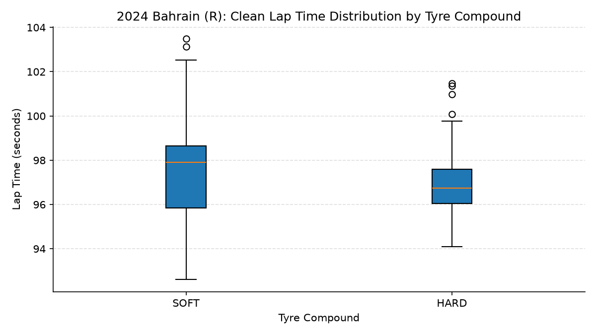
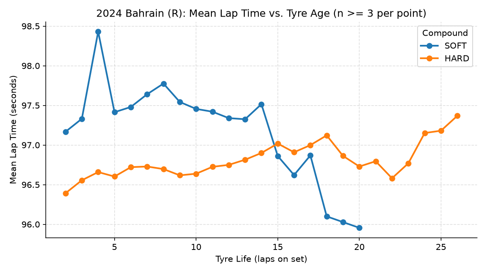
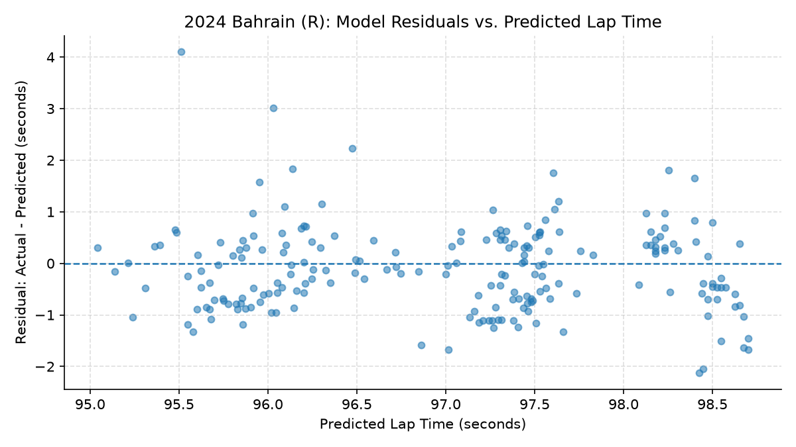

# Formula 1 Stint & Lap Time Data Science Pipeline

An end-to-end exploratory data analysis, statistical inference, and lap-time modeling pipeline built on real Formula 1 timing and weather data via [`FastF1`](https://docs.fastf1.dev/).

## Project Overview

In motorsport analytics, raw timing logs contain operational noise and measurement artifacts—such as pit-in/pit-out laps, safety car periods, traffic, and changing track conditions—that can distort naive analyses. This project demonstrates a structured data science workflow:

1. **Data Collection & Noise Filtering (`src/data_loader.py`):** Merges session lap timing with time-aligned weather telemetry (`merge_asof`) and removes pit laps, missing compound/age records, and anomalous slow laps (`> 107%` of median green-flag pace).
2. **Statistical Inference (`src/inference.py`):** Evaluates lap-time differences between the top two tyre compounds using **bootstrap confidence intervals** (`3,000` resamples) and **two-sided permutation testing** (`3,000` permutations) without relying on parametric normality assumptions.
3. **Baseline vs. Multivariate Modeling & Residual Analysis (`src/modeling.py`):** Compares a single-feature baseline (`TyreLife`) against a regularized `Ridge` regression pipeline incorporating tyre age, race progression (proxy for fuel burn), track temperature, and compound encoding, inspecting residual structure and error metrics.
4. **Diagnostic Visualization (`src/visualize.py`):** Generates compound distributions, stint degradation trends, and residual-vs-predicted diagnostic plots.

## Repository Structure

```text
.
├── README.md
├── requirements.txt
├── .gitignore
├── run_analysis.py
├── assets/
│   ├── lap_times_by_compound.png
│   ├── tyre_degradation_curve.png
│   └── residuals_vs_predicted.png
└── src/
    ├── __init__.py
    ├── data_loader.py
    ├── inference.py
    ├── modeling.py
    └── visualize.py
```

## Quickstart

```bash
python3 -m venv .venv
source .venv/bin/activate
pip install -r requirements.txt

python run_analysis.py --year 2024 --gp Bahrain --session R
```

Generated charts are saved under `./outputs/` (and tracked in `./assets/` for documentation), while downloaded session data is cached locally in `./f1_cache/`.

## Results & Key Findings (2024 Bahrain GP — Race)

- **Sample Filtering:** Filtered **1,129** raw laps down to **1,034** clean green-flag, non-pit laps (`95` pit/anomalous laps removed).
- **Non-Parametric Compound Comparison (`HARD` vs. `SOFT`):**
  - `HARD` (`n = 731`): mean `96.765s`
  - `SOFT` (`n = 303`): mean `97.461s`
  - Observed mean difference (`HARD - SOFT`): **`-0.695s`** (`95% Bootstrap CI: [-0.897s, -0.493s]`, permutation **`p = 0.0003`**).
  - **Confounding Insight (Fuel Load Effect):** Although `SOFT` tyres have higher mechanical grip, unadjusted race averages show `HARD` laps as faster because teams ran `SOFT` stints early in the race under heavy fuel loads, whereas `HARD` stints were predominantly run later when fuel weight had burned off.
- **Lap Time Prediction (Baseline vs. Multivariate Ridge Regression):**
  - **Baseline RMSE (`TyreLife` only):** `1.268s`
  - **Multivariate Ridge RMSE:** **`0.845s`** (`33.4%` error reduction)
  - **Multivariate Ridge MAE / $R^2$:** `0.661s` / `0.552`
  - **Residual Diagnostics:** Mean `-0.1174s`, standard deviation `0.839s`, max absolute error `4.102s`.
  - **Standardized Feature Effects:** Accounting for `race_progress` (`-1.205s` per SD, capturing fuel burn) and `TyreLife` (`+0.586s` per SD, capturing thermal/mechanical degradation) isolates tyre wear from fuel-load confounding.

### Visual Outputs







## Limitations & Future Work

- **Constructor & Driver Fixed Effects:** Residual variance (`std = 0.839s`) largely reflects pace differences across teams and drivers; incorporating team/driver encodings or fuel-corrected lap times would further reduce unexplained variance.
- **Multi-Race Generalization:** Extending evaluation across multiple circuits and weather regimes to test how tyre degradation rates generalize across varying track abrasiveness levels.

## Disclaimer

This project is an independent, non-commercial portfolio analysis. Timing and weather data are retrieved locally via the open-source `FastF1` library for educational and analytical purposes. Formula 1 and related marks are trademarks of Formula One Licensing B.V.